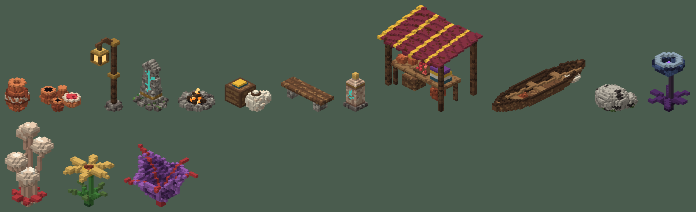
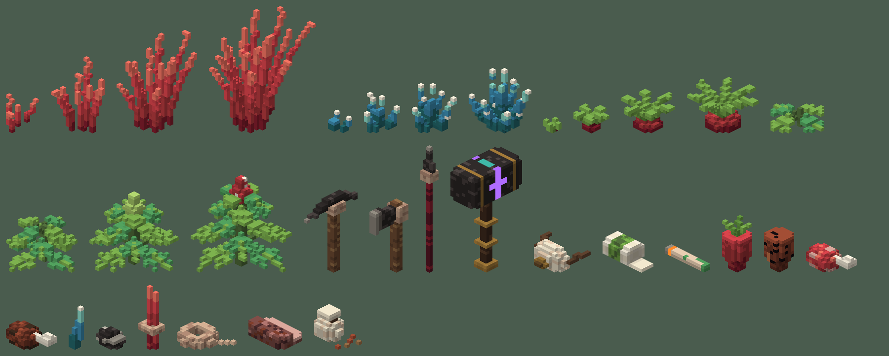
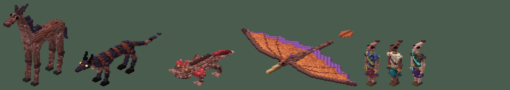
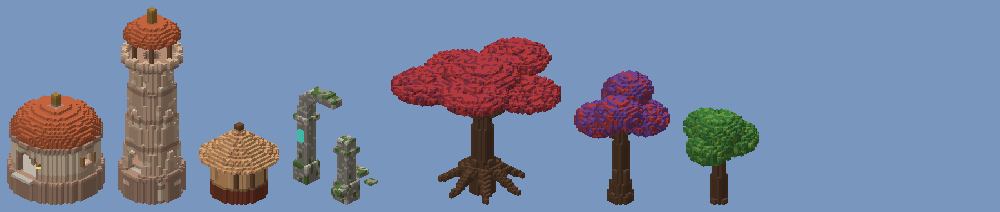
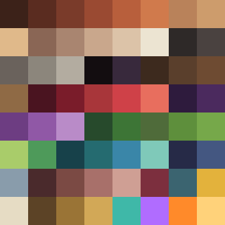

# Art pipeline

Everything you see that is not terrain noise comes from here: one palette, small voxel
models, and buildings that are stamped into the world. No textures.






To look at it all in the engine: start the game and click **Art gallery**, or open
`scenes/art/gallery.tscn` and press F6. The gallery does not need Voxel Tools.

## The palette

64 colours in named ramps, dark to light: `rust_1..6`, `sand_1..3`, `sandstone_1..5`,
`stone_1..5`, `ink_1..2`, `wood_1..4`, `crimson_1..5`, `violet_1..5`, `green_1..6`, `herb_1`,
`water_1..4`, `dusk_1..3`, `hide_1..4`, `cloth_wine/slate/mustard/linen`, `bronze_1..3`,
`glow_teal/violet/ember/lamp`.



- Aruun is a flourishing world: greens and water over red soil, with crimson and violet
  plants as the alien note.
- `glow_*` colours give off light. Teal and violet glow are for magick only.
- Source of truth: `tools/art/palette.py`. Exports in `content/art/`: `palette.json` (game),
  `aruun_palette.png` (drag onto MagicaVoxel's palette), `aruun_palette.gpl` (Krita, Aseprite, GIMP).
- Append colours, never reorder: models store palette positions.

## Two kinds of art

| | Models | Structures |
| --- | --- | --- |
| What | props, plants, crops, items, creatures, people | buildings, ruins, trees |
| Voxel size | 1/16 m (6.25 cm) | 0.25 m, the terrain voxel |
| In the world | separate meshes | stamped into terrain, so they can be dug and broken |
| Colours | any palette colour | block colours only (see `content/blocks/blocks.json`) |
| Files | `content/models/<category>/<id>.vox` + `models.json` | `content/structures/<id>.vox` + `structures.json` |

Both are plain MagicaVoxel `.vox` files. Things face forward (MagicaVoxel's front), stand on the
ground plane and are centred on the origin.

## Using art from code

```gdscript
var jar := ModelLibrary.instantiate("clay_jar", true)    # true = add a simple collision box
var beast: VoxelRig = ModelLibrary.instantiate("redstrider")
beast.play("walk")                                       # clips are listed in models.json
beast.part("head")                                       # pivot Node3D of a part
beast.set_manual("neck")                                 # stop animating a part and drive it yourself
var held := ModelLibrary.mesh("flint_axe")               # a Mesh; origin at the grip
var picture := ModelLibrary.icon("flint_axe")            # 64 px icon
var house := ContentDB.load_structure("vaari_dome_house")  # { voxels: [[x, y, z, block_id]] } for add_stamp
```

Models come out in world units already (1 unit = 0.25 m), so nothing needs scaling.
Crops have four growth stages: `grinleaf_s1` to `grinleaf_s4`.

Creatures are separate objects inside one `.vox` (body, head, legs...). The `rig` block in
`models.json` says which part hangs off which and where it pivots, and holds small
procedural clips (sine swings), enough for walk cycles until real animation exists.

Materials: `shaders/voxel_surface.gdshader` converts the palette colours correctly and gives
each voxel a slightly different brightness. Uniforms: `cell_size`, `world_cells` (true for
terrain), `value_jitter`, `roughness`, `metallic`, `emission_energy`.

## Making and changing art

- **By hand:** open any `.vox` in MagicaVoxel, edit, save. The game loads what you save.
  A file you have edited is never overwritten by the generator.
- **New model by hand:** save it under `content/models/<category>/`, add an entry to
  `models.json` (`file`, `category`, `voxel_m`).
- **From a free pack or a friend:** `python3 tools/art/import_vox.py file.vox --id name --category props --credit "..." --license CC0`
  recolours it to the palette and registers it. See `FREE_ASSETS.md`.
- **A new person:** `python3 tools/art/make_character.py warden --tunic stone:2 --skirt violet:2 --sash glow_teal --skin 4`.
- **The starter set** is generated by Python scripts in `tools/art/` (`props.py`, `flora.py`,
  `items.py`, `creatures.py`, `structures.py`). `python3 tools/art/build.py` rebuilds models,
  icons and the preview pictures above. Needs Python 3 and Pillow.
- Run `python3 tools/content_validator/validate.py` before committing. It checks colours,
  rig parts and that structures only use block colours.

## Known limits

- Rotated objects inside a `.vox` are read unrotated. Rotate the voxels, not the object.
- Exported builds must include `*.vox` and `*.json` (Export > Resources > filters).
- Voxel Tools' own `.vox` importer also picks these files up in the editor. That is harmless;
  the game reads the files directly.
- Vaari looks are exploratory, like the concept art. No first-person hands or HUD art yet.
