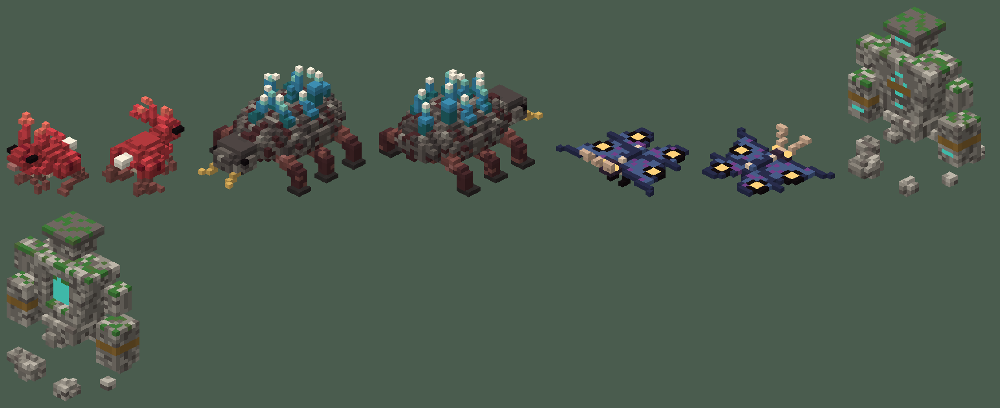

# Mobs

Generated from `tools/art/mobs.py` by `tools/art/build.py`. Edit the sheet there, or tell us what to change.
Stats are left to the gameplay code; this is the intent.

## Reedhopper (`reedhopper`)

**Passive prey. First food and hide for a new player.**

- Size: 0.6 m tall with ears up
- Where: Riverbanks and reed beds, in groups of 3 to 6, by day.
- Behaviour: Grazes and freezes when watched. Bolts in long low-gravity hops when you come within 6 m or when one of the group is hit. Hides in vermillion reeds, where its red back disappears.
- Attacks: None.
- How to beat it: Approach crouched from downwind, or throw a spear. A Graviturge can pin one mid-hop.
- Drops: raw_meat, hide (small)
- Alien touch: Four tiny forelimbs for feeding, two huge hind legs; feathery ear-gills.
- Animation clips: idle, alert, hop

## Glassback (`glassback`)

**Defensive tank. Dangerous only if provoked or cornered.**

- Size: 1.4 m long, 0.9 m tall
- Where: Rocky slopes and highland meadows, alone or in pairs.
- Behaviour: Slow six-legged grazer that grows glasswort-like crystal on its shell to store water. Ignores you until hit or crowded for a few seconds, then lowers its head and charges in a straight line.
- Attacks: Charge (heavy knockback, long recovery). Shell spikes hurt anything that strikes its back.
- How to beat it: Sidestep the charge and hit the soft flank or belly while it recovers. Lifting it with gravity magick flips it onto its back for a few seconds.
- Drops: glasswort_leaf, hide, raw_meat; crystal shards (future crafting)
- Alien touch: All six legs kept; crystal garden on its back.
- Animation clips: idle, walk, charge

## Duskmoth (`duskmoth`)

**Night nuisance in swarms. Makes campfires and lamps a choice.**

- Size: 1.3 m wingspan
- Where: Forest edges and meadows from dusk to dawn, 3 to 8 together.
- Behaviour: Drifts on four wings and is drawn to light: campfires, lamps and glowing inscriptions. Circles the light, then dives at whoever stands nearest. Scatters at dawn or if the light goes out.
- Attacks: Dive (light damage). Wing dust briefly blurs vision if three or more hit in a row.
- How to beat it: Fight in the dark, or lure them with a lamp placed away from camp. Fragile: one or two hits each.
- Drops: wing dust (future: lamp oil, dye), cord fibre
- Alien touch: Four wings and two grasping legs; lamp-coloured eye spots that glow.
- Animation clips: idle, dive, rest

## Echo Sentinel (`echo_sentinel`)

**Ruin guardian and mini-boss. Teaches the gravity magick lesson before the real boss.**

- Size: 2.6 m tall, hovering
- Where: Ancient ruins only. Dormant as a pile of stones until someone enters its hall.
- Behaviour: Old-builder stonework held together by gravity magick around a lit core. Hovers, keeps its distance, then closes to slam. Its stones fall apart for a moment after each slam and when it is staggered.
- Attacks: Fist slam (shockwave on the ground), thrown orbit stones, a pull that drags you in before a slam.
- How to beat it: The core is exposed from behind and whenever the stones part. Blocks are immune to weapons; use the gravity word to drop a fist or pull stones away, then strike the core.
- Drops: ancient_stone, bronze fittings, an Avarra word fragment
- Alien touch: Not alive: teal Avarra glow marks it as magick.
- Animation clips: idle, walk, slam, dormant
